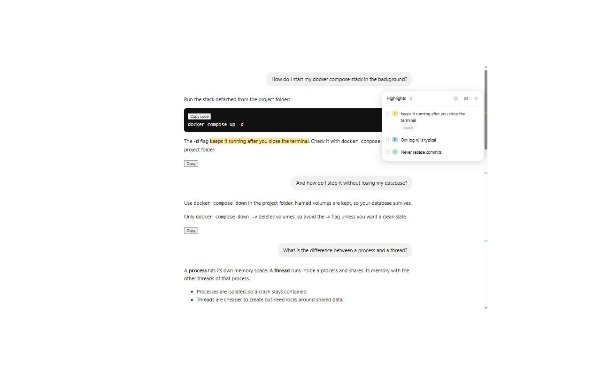
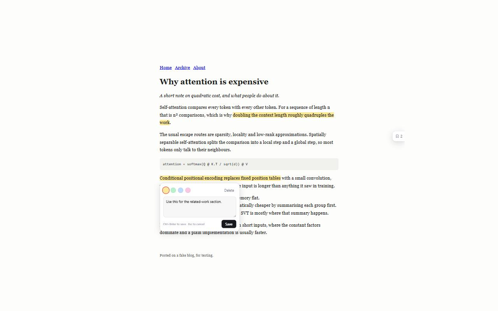
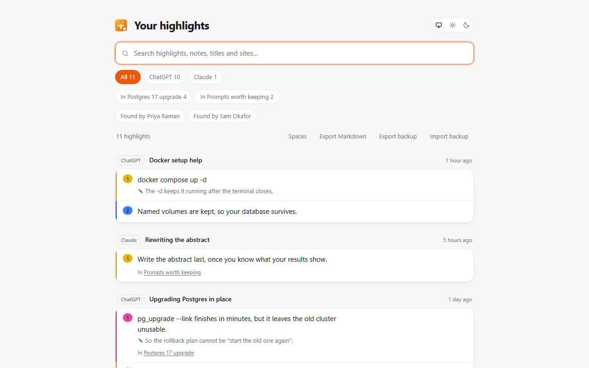
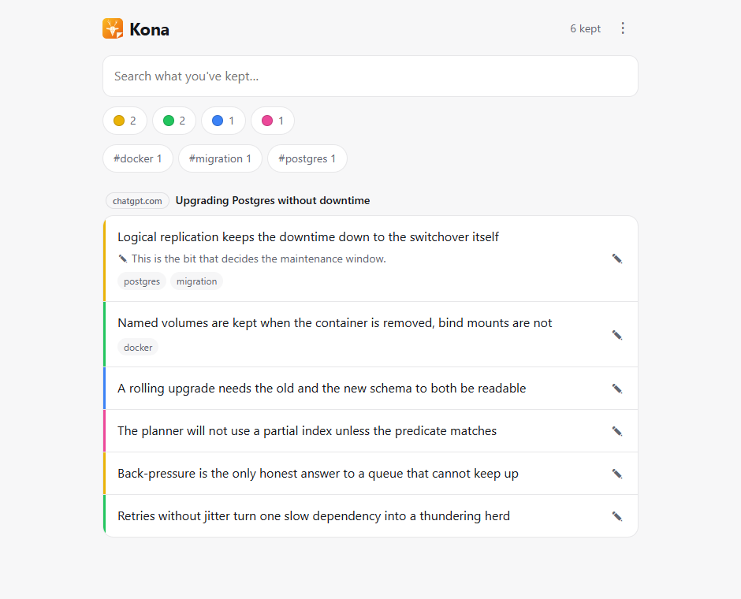
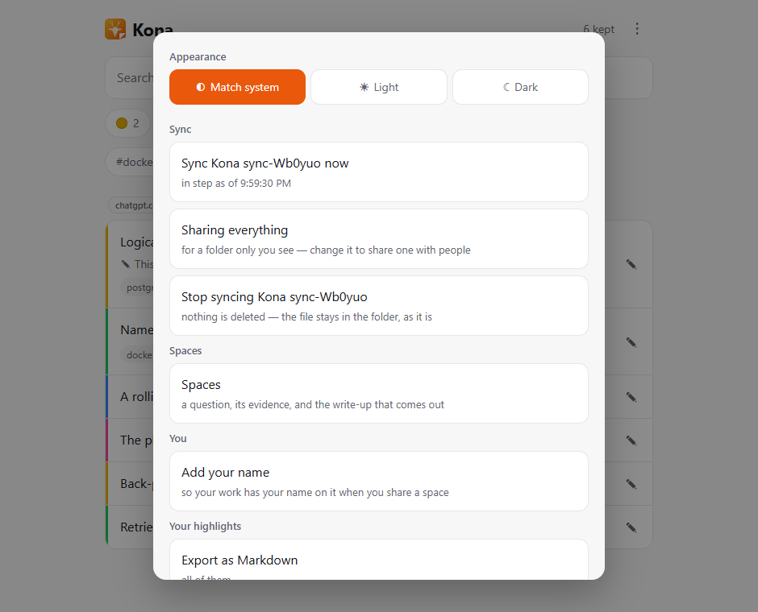
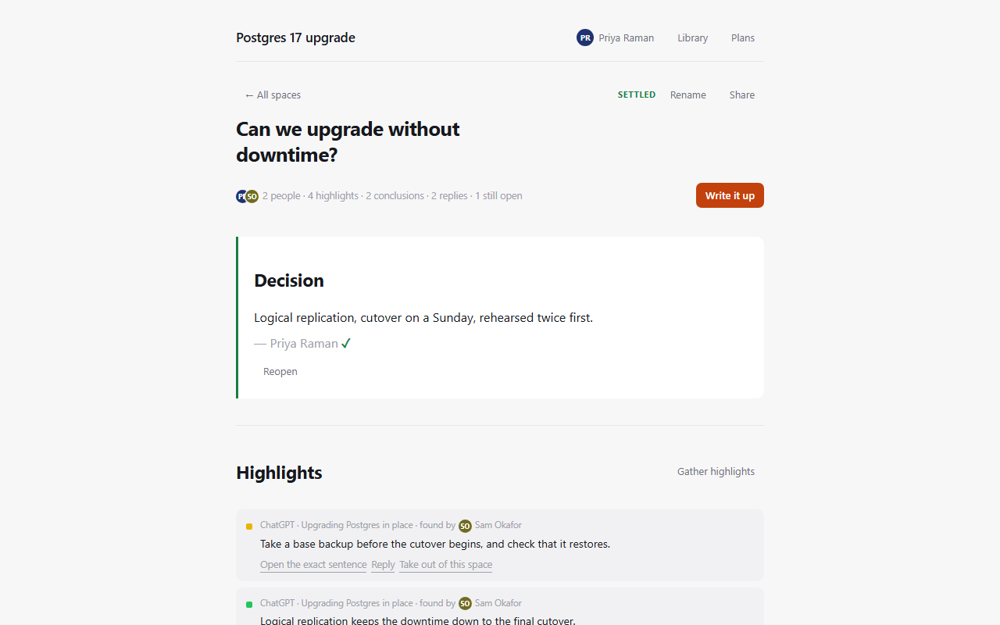

# Kona

A browser extension that highlights text on web pages and in AI chats, saves it with
your notes, and takes you back to the exact spot later. Everything is stored on your
own computer and nothing is sent anywhere.

The highlights you gather around one question become a **space**: the evidence, what you
concluded from it, what you still do not know, and a write-up where every passage and
every claim links back to the exact sentence behind it — checkable by someone who has
never installed Kona. A space is a file you can hand to a colleague and take back with
their work in it.

There is also a small phone app that keeps text you share to it from any Android app.

On Apple platforms Safari runs the extension itself — on iPhone and iPad as well as on a
Mac — and that build is in `apple/`.

> **Status:** early prototype, not in the Chrome Web Store yet. Install it yourself with the steps below.



## What it does

**While you read**
- Select text in any message on **ChatGPT**, **Claude** or **Gemini** and pick a colour.
- Or right-click the selection and choose **Highlight with Kona** — handy on sites whose own selection popup covers ours.
- Switch it on for **any other site** from the toolbar button: blogs, docs, Stack Overflow, GitHub.
- Switch any site **off** from the same button, the chat sites included. Everything disappears on that site and selections are ignored, while your highlights stay saved and return when you switch it back on. "Forget" an added site to hand its permission back to Chrome as well.
- Add a note to any highlight with the ✎ button, or by clicking highlighted text later. Highlights with notes get a dotted underline.
- Tag a highlight in the same box. Tags pull related highlights together across chats and sites.
- A side panel lists this page's highlights, numbered in the order you made them. Drag the ⋮⋮ grip to reorder, hover an entry to light up its highlight, click it to jump there.
- In a long chat, jumping to a highlight in a part the site hasn't loaded yet scrolls up for you until it finds it.
- Coloured ticks beside the scrollbar show where your highlights are on the page, with a box marking what's on screen. Click a tick to jump there.
- Deleting a highlight leaves an **Undo** for a few seconds, in the page and in the library.
- Highlighting waits while a reply is still being written.

**Afterwards**
- `Alt+Shift+F` opens a search box over everything you've saved, right on the page you're reading. Picking a result from another chat opens it there.
- One library holds every highlight from every site, labelled with where it came from, filterable by site and searchable by text, note, chat name or site.
- Search finds the passage that says your thing in other words. Alongside the usual keyword ranking it measures which words keep turning up together in *your* highlights, and widens a query along those pairs — so a search for `downtime` turns up the one that only ever says `cutover`. It names the word that did it, and a library too small to have taught it anything claims nothing.
- Clicking a highlight opens that page and scrolls straight to it, re-using the tab if it's already open.
- Every highlight has a copyable link that lands on the exact spot. It is an ordinary URL
  text fragment, so it works for people who don't have Kona, and on a phone.
- Filter by tag as well as by site, and search covers tags too. Once you have spaces, filter by which space holds a highlight, and — in a space that has been round to a colleague and back — by who found it.
- Change a highlight's note and tags from the library, not only from the page it came from.
- Put your name to your work and your computer makes a signing key. Everything you write in a shared space is signed with it, and a space coming back is checked against the key you already hold for that person — so nobody can write a reply in your name, and anything whose words moved after it was signed is flagged rather than hidden. It proves the sender is the same person as last time; it does not prove who they are in the world, which is what an account would add.
- Export what you're looking at as Markdown — one section per chat, with your notes, tags and a link back — which drops straight into Obsidian or Notion.
- Export a backup file of everything — highlights, spaces and your name — and import it on another computer.
- Or point Kona at a folder your machine already syncs (Drive, Dropbox, iCloud, OneDrive, Syncthing) and it keeps the library there. Your own folder keeps your own computers in step; a folder you share with somebody keeps a space in step with them, with no file to send and their replies arriving on their own. Kona makes no network request to do it — it writes a file, and something you already trust carries it.
- Which folder it is decides who can read what, so Kona asks before writing anything. A folder of your own carries everything. **A folder you share carries only the spaces you tick, and only the passages those spaces cite** — nothing else in your library is written there.
- Keeping that folder in step from inside a browser needs a folder picker, which only desktop Chrome, Edge and Brave have. Everywhere else — Firefox, Safari, the phone app — **Sync through a file** does the same pass by hand: open the file out of the folder, and Kona hands back the one to put where you found it. Same file, same merge, same choice of what goes in it, so a team is not split by somebody's browser.
- Or run **[the desktop app](#the-desktop-app)**, where a folder is a path rather than a permission. It keeps the folder in step on its own, on Windows, macOS and Linux alike, and it goes on doing it with the window shut.
- Light, dark or match-your-system, chosen in the library and used everywhere, including the panel inside chats.

**When pages change**
- Highlights are found again by their text and its surroundings, so they survive re-renders, edited messages and changed message ids.
- A copy of the text is saved with each highlight, so you keep it even if the chat is deleted.
- If a site changes its layout, the panel says so instead of failing silently.

## Screenshots

| Any web page, with a note | The library |
|---|---|
|  |  |
| **The desktop app** | **The folder it keeps in step** |
|  |  |

*Screenshots use a sample conversation and a sample article.* The desktop pair is captured
from the real app against a real folder by `node scripts/desktop-shot.mjs`.

## Install

Requires Node.js 20 or newer.

```bash
npm install
npm run build
```

Then open `chrome://extensions`, turn on **Developer mode**, click **Load unpacked** and choose `.output/chrome-mv3`. Works in Chrome, Edge and Brave.

Open a chat on chatgpt.com, claude.ai or gemini.google.com and select some text. For any other site, click the Kona button in the toolbar and switch that site on; Chrome will ask you to allow it.

## On a phone (Android)

Chrome on Android has no extensions, and Google has not said it ever will. So the phone
version is a small installable web app instead of an extension, in `app/`.

Select text anywhere on the phone — a browser, Reddit, a PDF reader — tap **Share**, pick
**Kona**, and the passage is kept with its page and title. Give it a colour, a note and
tags, filter by either, search everything later, and **Open original** takes you back to the exact sentence
using a URL text fragment, which every modern browser understands without anything
installed.

Spaces are here too, and are the same thing they are on a desktop: a question, the
highlights that bear on it, what you concluded, and a write-up citing the exact sentence
behind every claim. A space can be handed over as a file and taken back with the other
person in it, replies and all, and what you write is signed with a key this phone makes.
A backup carries the spaces and your name as well as the highlights, so moving to a new
phone brings the lot.

```bash
npm run dev:app     # http://localhost:5179
npm run build:app   # a static site in .output/site/app
```

Every push publishes it to GitHub Pages, so it lives at
**https://aniketpandey05.github.io/kona/app/**. Open that on your phone and use
*Add to Home screen*. Android installs it as a real app: its own icon in the drawer, its
own window, its own entry in Settings. **Sharing only appears once it is installed**, which
is the step people miss.

Text shared from an app rather than a browser usually arrives without a link, because
there is nothing to link to — the conversation lives inside the app. Both ChatGPT and
Gemini can mint a public link for a whole conversation from their own share menu — share
that link to Kona as well, and it offers to attach itself to everything kept from that
conversation at once.

To hand it to someone as a file instead, [Bubblewrap](https://github.com/GoogleChromeLabs/bubblewrap)
wraps the same site in an APK they can download and sideload. The Play Store takes that
APK too, for a one-off $25 developer account — though new personal accounts have to run a
closed test with 12 testers for 14 days before they are allowed to publish.

It keeps its own highlights, separate from the desktop ones; nothing syncs between them.
The backup file is the same format in both, so you can carry highlights across by hand.
This is the Android path and only that: Safari has never let a web app register as a
share target, so an iPhone cannot be shared to this way — and does not need to be,
because Safari has real extensions.

## On an iPhone, iPad or Mac (Safari)

Phones are the other way round from what you would expect. Chrome on Android has no
extensions and Google has not said it ever will; Safari has had them on iPhone and iPad
since iOS 15. So the Apple version is not a web app at all — it is this extension, built
from the same source, highlighting inside the page on a phone the way it does on a
desktop.

```bash
npm run build:safari   # .output/safari-mv3 — builds on any OS
apple/package.sh       # wraps it in the app Apple requires; needs a Mac with Xcode
```

Safari 17.2 is the floor, because that is where the CSS Custom Highlight API landed, and
on an iPhone that is the iOS version too. Two things differ from Chrome: a phone has no
right-click, so **Highlight with Kona** is a Mac-only convenience, and Safari asks about
each site in its own prompt rather than Chrome's. As with the Android app, highlights
stay in the browser they were made in, and the backup file is what carries them across.

Every Safari extension ships inside an app, built with Xcode and signed, so this is the
one part of Kona that needs a Mac and a paid developer account.
[`apple/README.md`](apple/README.md) covers all of it, including which parts have not
been run on a Mac yet.

## The desktop app

```bash
npm run build:desktop
npm run start:desktop
```

Kona in a window of its own, on Windows, macOS and Linux. It exists for one reason: a
web page only runs while you are looking at it. The extension can only sync while a Kona
tab is open, because Manifest V3 stops a background page after a few seconds of quiet,
and the phone app syncs when you tap it. Neither is wrong, and neither is *my highlights
are on both my machines without my thinking about it*.

This is. Closing the window hides it to the tray instead of quitting, and the renderer
keeps running while it is hidden, so the folder stays in step while you are doing
something else. Start it with `--hidden` — which is what a launch-at-login entry should
do — and it syncs without ever showing a window at all.

The other half is that a folder here is a **path**, not a handle behind a permission.
There is no picker to be missing, so Firefox and Safari are no different from Chrome, and
nothing has to be granted again after a restart. The same engine, the same merge and the
same choice of what the folder carries as everywhere else — `src/core` is shared, and the
window renders the same UI as the phone app.

What it is not:

- **It is a peer on the folder, not a bridge into your browser.** It keeps its own
  library and meets your extension in the shared folder, the same way another computer
  would. On Chrome, Edge or Brave your extension is in that folder too and the loop is
  closed; on Firefox and Safari the extension still does its hop by hand.
- **There are no installers yet.** It builds and runs from source, as above. Packaging
  and signing for three platforms is real work and none of it is done.
- **It does not reach a phone.** iOS and Android do not run this, and that is the gap
  Pro's sync is for.

`node scripts/desktop-check.mjs` launches the real app against a real folder with no
window shown, takes the sync file away, and checks it comes back with the highlights in
it — the claim that only running the thing can check.

## Spaces

The library keeps everything you ever marked, newest first. A **space** is the other thing
you need: one question, the handful of highlights that bear on it, what you concluded from
them, and what you still do not know.

Open **Spaces** from the library toolbar. Make one for whatever you are working out — a
migration, a literature review, a decision somebody will ask you to justify — then gather
the highlights that bear on it from anywhere in your library.

That is enough. Three passages in a space and **Write it up** already gives you a
document. Anything further is optional: write down a conclusion and it goes on top,
citing the highlights it rests on. Mark the ones that cut against it, because evidence
that all nods along is usually evidence that stopped looking. Keep a list of what is
still unknown. Record the decision when there is one.



*A space built from the sample conversations, with one finding's evidence open.*

The write-up is the question as the title, the decision, your conclusions each carrying
the sources behind them, every passage quoted underneath with its note, what is still
open, and a numbered source list. Every citation is a link that lands on the exact
sentence, so whoever reads it can check any claim in one click without having Kona. Copy
it as Markdown or save it as a `.md` file.

Take a highlight back out of a space and any finding resting on it says so rather than
quietly standing on less — the claim is marked as short a source, in the space and in the
write-up both. A highlight deleted from the library does the same. Deleting a space leaves
every highlight where it was.

All of it is stored on your own computer like everything else, and none of it needs an
account.

### Handing a space to someone

Press **Share** and a space becomes a file: the question, the passages, your conclusions
and the links. Whoever opens it with **Open one someone sent** gets the lot, can add a
passage or argue with a conclusion, and can send it back.

Fitting an arriving space into a library that has its own ids is the fiddly part, and it
is handled: highlights are matched on the passage and the conversation it came from, not
on an id neither side agreed, so the same sentence does not arrive twice. Your own notes
are never overwritten by a visitor's. A file from somebody else is rebuilt field by field
rather than trusted — a claim may only cite highlights that came in the same file, and a
highlight with an address no link can be built from is dropped.

Two people cannot be in one space at the same moment this way. That is the part that
needs a server.

## The paid tier, as a demo

Everything above is free and stays free — spaces and sharing one included. The planned
paid product is the same spaces *live*: everyone in one at once, instead of passing a
file around. That part needs a server, and it is the part that is not built.

`team/` is a working demo of it — not a product, and not connected to anything. It runs
the same `src/core` the extension does, over an invented company's highlights, and it
exists so the difference between free and paid can be seen rather than described.

```bash
npm run dev:team     # http://localhost:5180
npm run build:team   # into .output/site/team
```

It opens on the free plan, showing only your own highlights and saying how many of your
colleagues' are missing. Upgrading walks through checkout, and the same screens come back
with the whole workspace in them.

What a team works in is a **space**: one question, the evidence gathered under it, what
is still unknown, and the decision that came out. It writes itself up as a memo where
every claim cites the exact sentence it came from — and those citations work for someone
who has never installed Kona. A space with no question is just a shelf, like a prompt
library, which is the same object with nothing to settle.

The extension's own **Plans** page says all of this too, including which plan you are on
and that nothing in it asks you for a card. `src/core/plans.ts` is the copy of record for
what Kona costs; the landing page mirrors it.

There is also an admin page showing the entitlement token the client would be caching,
because that is the part of billing worth getting right — a Stripe outage must never lock
a paying customer out of their own highlights.

Checkout is a local stand-in by default, so the demo runs with no account and no keys, and
says so on screen. Point `VITE_STRIPE_PAYMENT_LINK` at a test-mode Stripe payment link and
the same button hands off to Stripe instead.

[`docs/enterprise.md`](docs/enterprise.md) is the plan behind it: who buys it, the tiers,
the billing architecture, the security posture and the order it gets built in.

## Keyboard shortcuts

| Keys | What happens |
|---|---|
| `Alt+Shift+H` | Highlight the selected text in yellow |
| `Alt+Shift+N` | Highlight it and open a note |
| `Alt+Shift+↓` / `↑` | Go to the next or previous highlight, with a "3 of 7" marker |
| `Alt+Shift+F` | Search everything you've highlighted, without leaving the page |
| `Ctrl+Enter` | Save the note you're writing |
| `Esc` | Close the note without saving |
| `↑` / `↓` on the ⋮⋮ grip | Move a highlight up or down the list |

The first two are also listed along the bottom of the panel, and a welcome page walks through all of it the first time you install.

## Privacy

Everything is stored in your browser, and the extension makes no network requests of any kind. It asks for access to the three chat sites, plus whichever sites you switch on yourself — nothing else. Your backup file is the only copy that leaves the browser, and only when you export one.

## Development

```bash
npm run dev       # Chrome with the extension loaded, rebuilding on save
npm run dev:site  # the landing page on localhost:5181
npm test          # unit tests for anchoring, ordering, search and backups
npm run compile   # type check
npm run build     # production build in .output/chrome-mv3

npm run build:desktop  # the Electron app into .output/desktop
npm run start:desktop  # run it
```

The published site is one GitHub Pages deploy with three things in it: the landing page at
the root, the phone app under `/app/`, and the Team demo under `/team/`.

```bash
npm run build:web     # all three, in the order that works
npm run preview:web   # serves the whole thing on one port, as it will be published
```

`build:web` clears `.output/site` once and then runs the three in order. The individual
builds do not clear it, because they share that directory — a `build:site` that emptied it
would take `/app/` and `/team/` with it, and nothing would say so until a link 404ed.

Use `preview:web` rather than the individual dev servers whenever you want to click
between the three. Each `dev:` server only knows about its own folder, so a link to
`/team/` from the landing page's dev server falls back to the landing page itself — which
looks exactly like a broken demo and is not one.

| Piece | Where |
|---|---|
| Site-specific markup — the only part that should break when a site changes | `src/adapters/` |
| Which hostnames count as the same site | `src/core/enabledSites.ts` |
| Flattening a message's text and mapping offsets to DOM ranges | `src/core/textIndex.ts` |
| Storing a highlight as quote + surrounding context, and finding it again | `src/core/quote.ts` |
| Finding the right message by id, fingerprint or nearby position | `src/core/locate.ts` |
| Painting highlights with the CSS Custom Highlight API, without touching the page | `src/core/painter.ts` |
| Panel order, search, backups, deep links | `src/core/order.ts`, `search.ts`, `backup.ts`, `link.ts` |
| A question, its evidence, and the write-up that comes out | `src/core/spaces.ts`, `memo.ts` |
| Handing a space to someone, and fitting one that arrives into your library | `src/core/spaceShare.ts` |
| What Kona costs — the copy the extension and the site both use | `src/core/plans.ts` |
| The Android web app — shares `src/core` with the extension | `app/` |
| The desktop app — the same UI, with a folder that is a path | `desktop/` |
| The Team demo — the paid tier, on the same core | `team/` |
| The landing page, and the root of the published site | `site/` |
| Wrapping the Safari build in the app Apple requires around it | `apple/` |
| Page logic: selection, navigation, jumping, storage | `src/content/controller.ts` |
| Panel, toolbar and note card (Preact, in a shadow root) | `src/ui/` |
| Library page, spaces page, plans page, welcome page, toolbar popup, background script | `src/entrypoints/` |

## Fixing a site that broke

When a site changes its layout, the panel shows a warning. The fix is usually a selector change in that site's adapter, for example `src/adapters/chatgpt.ts`. Each adapter answers the same few questions — where the messages are, which are yours, where a message's text lives, and whether a reply is still being written — so nothing outside that file should need touching.

## Releasing

```bash
npm run zip          # .output/kona-<version>-chrome.zip for the Chrome Web Store
npm run zip:firefox  # the same for addons.mozilla.org, plus a sources archive
npm run zip:safari   # the extension resources, for the App Store Connect upload
```

`CHROMEWEBSTORE.md` holds the listing copy, the permission justifications and the data-use
answers, so the submission form can be filled in from one place. The privacy policy is
served at <https://aniketpandey05.github.io/kona/privacy.html>.

## Contributing

Issues and pull requests are welcome.

The most useful thing anyone can fix is a site that has changed its markup, because that
is the one thing guaranteed to break. Each site is a single file in `src/adapters/`
answering the same few questions — where the messages are, which are yours, where a
message's text lives, and whether a reply is still being written. Nothing outside that
file should need touching.

```bash
npm install
npm test          # the suite, which runs without a browser
npm run compile   # type check
npm run dev       # Chrome with the extension loaded, rebuilding on save
npm run dev:app   # the phone app on localhost:5179
```

Anything that changes behaviour should bring a test with it. The core is deliberately
free of the DOM so that is cheap to do.

## License

Business Source License 1.1 — see [LICENSE](LICENSE).

Read it, change it, build it, share it, and use it for anything you like — at home, at
work, or across a company of any size. The single carve-out: you may not offer Kona to
other people as a hosted or managed service. That is the one thing reserved, because it
is the thing we intend to sell.

On **2030-10-28** this converts automatically to AGPL-3.0-or-later, and the carve-out
goes away. Any version also converts on its own fourth birthday, whichever comes first.

Releases up to and including **1.1.0 were AGPL-3.0-or-later** and stay that way; nothing
about this changes what was already published under those terms.

BSL is not an OSI-approved open source licence, and this README should not call it one.
It is source-available: the code is all here to read, build and modify.

The extension and the phone app are free, run entirely on your own computer, and will
stay that way. A hosted workspace for teams — shared highlights alongside your private
ones — is planned separately, and that will be paid. It is a separate service; nothing
moves out of the free version into it.

The built extension bundles Preact, which is MIT and so freely combinable with this.
Its notice travels inside the package as `THIRD-PARTY-NOTICES.txt`, which is what its
licence asks for. Nothing else Kona depends on ends up in the shipped code; the rest is
build tooling.
